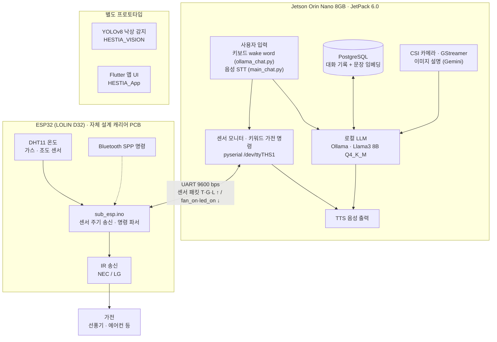

# HESTIA

**독거노인을 위한 대화형 AI 홈 어시스턴트 디바이스** 
Jetson Orin Nano 로컬 LLM · ESP32 센서 허브 · IR 가전 제어

생성 AI를 이용한 지속 가능한 대화형 인공지능 디바이스 — Sustainable interactive AI device using generative AI

 

> **English summary** — HESTIA is a conversational home assistant for elderly people living alone. A Jetson Orin Nano runs a local Llama3 8B (Q4_K_M) model through Ollama, keeps per-user conversation memory in PostgreSQL with sentence embeddings, and talks to an ESP32 (LOLIN D32) board over UART. The ESP32 streams temperature / gas / light readings and drives home appliances with IR remote codes (NEC, LG). A YOLOv8 fall-detection demo and a Flutter app UI were built as separate prototypes.

---

## 프로젝트 소개

HESTIA는 혼자 사는 어르신의 말벗이 되어 주고, 집 안 환경을 살피며, 말로 가전을 켜고 끌 수 있게 하는 홈 어시스턴트입니다.

- **로컬 LLM 대화** — Jetson Orin Nano에서 Ollama로 Llama3 8B Q4_K_M 모델을 직접 구동 (`ollama_chat.py`)
- **대화 기억** — 사용자별 대화를 문장 임베딩과 함께 PostgreSQL에 저장하고, 관련 대화를 다시 불러와 답변에 반영
- **환경 센싱과 먼저 말 걸기** — ESP32가 보낸 온도·가스·조도 값에 따라 안내 발화, 일정 시간 대화가 없으면 카메라로 상태 확인 후 말 걸기
- **가전 제어** — 키워드 명령("선풍기 틀어줘")을 UART로 ESP32에 전달 → IR 리모컨 신호로 선풍기 등 제어
- **전용 하드웨어** — ESP32(LOLIN D32)용 센서·IR·UART 캐리어 PCB 자체 설계 (2층, 거버 포함)

개발 기간: 2024.04 – 2024.11 (커밋 기준)

## 시스템 아키텍처

- 선풍기는 UART 명령 → IR NEC, 에어컨은 Bluetooth 명령 경로 → IR LG 프로토콜로 제어합니다.
- TTS(OpenAI `tts-1`), 카메라 이미지 설명(Gemini 1.5 Flash), 웹 검색·날씨는 클라우드 API를 사용합니다. 대화 LLM은 로컬에서 동작합니다.
- 낙상 감지와 앱 UI는 메인 애플리케이션과 통합되지 않은 별도 프로토타입입니다.

## 기술 스택

**Hardware / Embedded** 

**AI / Software** 

## 저장소

> 일부 저장소는 비공개입니다. Some repositories are private.

| 저장소 | 설명 | 주요 기술 |
|---|---|---|
| [HESTIA_SW](https://github.com/MJU-HESTIA/HESTIA_SW) | Jetson 애플리케이션 — 로컬 LLM 대화, 대화 기억, 센서 연동, 가전 명령 | Python, Ollama, PostgreSQL, pyserial |
| [HESTIA_FW](https://github.com/MJU-HESTIA/HESTIA_FW) | ESP32 펌웨어 — 센서 주기 송신, UART/Bluetooth 명령 → IR 가전 제어, 얼굴 추적 서보 실험 | Arduino-ESP32, IRremote, ESP-IDF |
| [HESTIA_PCB](https://github.com/MJU-HESTIA/HESTIA_PCB) | LOLIN D32 기반 2층 캐리어 PCB — 센서·IR 모듈·UART·전원 커넥터, 거버 포함 | EasyEDA |
| [HESTIA_HW](https://github.com/MJU-HESTIA/HESTIA_HW) | 하드웨어 구성 개요 — 보드 간 연결, 핀·링크 정리 | – |
| [HESTIA_AI_Model](https://github.com/MJU-HESTIA/HESTIA_AI_Model) | 로컬 LLM 설정 — Llama3 8B Q4_K_M Modelfile, Jetson용 Ollama CUDA 빌드 절차 | Ollama, GGUF |
| [HESTIA_VISION](https://github.com/MJU-HESTIA/HESTIA_VISION) | YOLOv8 낙상 감지 데모 (별도) | Ultralytics YOLOv8, OpenCV |
| [HESTIA_App](https://github.com/MJU-HESTIA/HESTIA_App) | 스마트홈 제어 앱 UI 프로토타입 (별도) | Flutter |

## 하드웨어 · 검증 환경

| 항목 | 내용 |
|---|---|
| 메인 컴퓨터 | NVIDIA Jetson Orin Nano 8GB — JetPack 6.0 (L4T 36.3.0), Ubuntu 22.04 |
| MCU | ESP32 (LOLIN D32) + 자체 설계 캐리어 PCB |
| 센서 | DHT11 온도, 가스 센서, 조도 센서 |
| 액추에이터 | IR 송신 모듈(가전 제어), LED |
| 입출력 | CSI 카메라, 마이크, 스피커, 디스플레이 |
| Jetson ↔ ESP32 | UART `/dev/ttyTHS1` ↔ UART2, 9600 bps, 줄 단위 ASCII 프로토콜 |

## 팀 · 역할

| 구성원 | 역할 |
|---|---|
| **이승석** ([@seukseok](https://github.com/seukseok)) | 전체 시스템 통합, Jetson 소프트웨어(로컬 LLM 연동·대화 기억·센서 연동), ESP32 펌웨어, IR 가전 제어, PCB 공동 설계 |
| 팀원 | PCB 회로도·레이아웃 공동 설계 |
| 팀원 | Flutter 앱 UI |

## 향후 계획

- 응답 지연 단축, 단일 스크립트를 `uart / sensors / llm / tts / memory` 모듈로 분리
- 가전 제어를 키워드 매칭에서 LLM 라우터 기반으로 확장
- UART 프로토콜 프레이밍·오류 검출 보강
- 로컬 모델 파인튜닝, 하우징 개선
